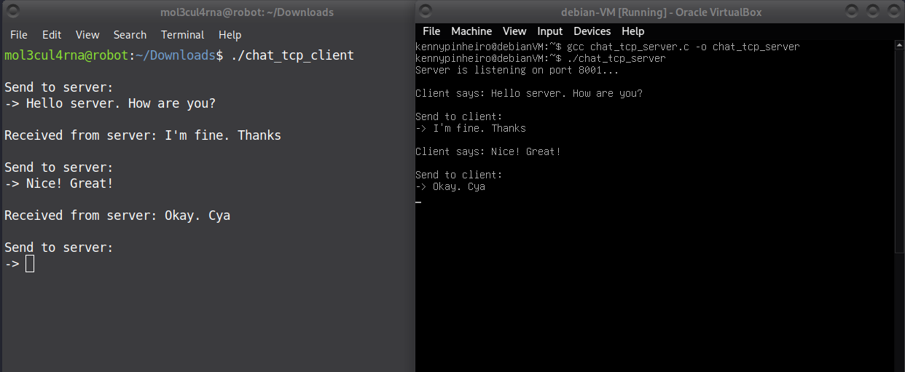

# 💻 Sockets in C - Terminal chatting

Um socket está associado a um file descriptor que por sua vez está associado a um processo sendo rodando na memória para possibilitar a comunicação entre 2 hosts através da rede de computadores.

[Arquivo fonte - Client](https://github.com/kennypinheiro/linguagem_C/blob/main/02_Sockets/chat_tcp_client.c)

[Arquivo fonte - Server](https://github.com/kennypinheiro/linguagem_C/blob/main/02_Sockets/chat_tcp_server.c)

---

## 📚 Referência

* [geeksforgeeks](https://www.geeksforgeeks.org/c/socket-programming-cc/) — Texto bem didático e completo.

* [Canal Youtube - dr Jonas Birch](https://www.youtube.com/watch?v=pA1PPpQ_SHY) — Ótimo vídeo introdutório sobre o assunto.

---

> *Nota: Parte da estruturação e refinamento textual deste documento foi auxiliada pelo Google Gemini.*
